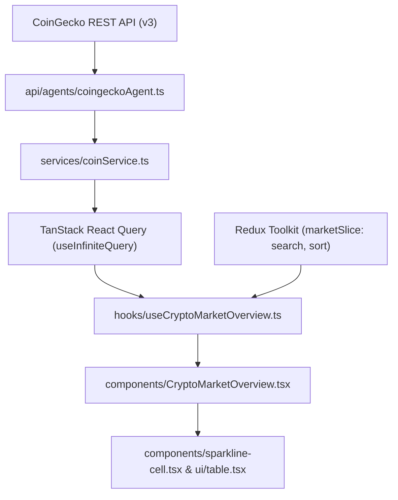

# Architecture and Data Flow

This document details the architectural decisions, data flow pipelines, and state separation models used throughout StreamCoin.

## High-Level Architecture

StreamCoin follows a unidirectional, multi-tiered architecture that strictly decouples external data fetching from the presentation layer.



## Layer Responsibilities

### 1. API Agent Layer (`api/agents/`)
The agent layer is the only layer responsible for knowing external endpoints, protocol requirements, query parameters, and fetch configurations.
- `coingeckoAgent.ts`:
  - Interacts with `https://api.coingecko.com/api/v3/coins/markets`.
  - Configures Next.js cache revalidation (`next: { revalidate: 60 }`).
  - Converts errors into application exceptions when non-200 responses occur.
  - Returns raw, strongly-typed JSON data conforming to the `Coin[]` interface.

### 2. Service Layer (`services/`)
The service layer serves as an abstraction barrier between raw network clients and application consumption.
- Prevents UI components and custom hooks from coupling directly to third-party SDKs or specific endpoints.
- Allows mocking or swapping data providers (e.g., migrating from CoinGecko to Binance or CoinMarketCap) without modifying hooks or UI code.

### 3. State Management: The Hybrid Split
StreamCoin uses a deliberate separation between **Server State** and **Client UI State**.

```text
┌─────────────────────────────────────────────────────────────┐
│                       STATE SEPARATION                      │
├──────────────────────────────┬──────────────────────────────┤
│  Server State (React Query)  │   Client UI State (Redux)    │
├──────────────────────────────┼──────────────────────────────┤
│  • Coin market data pages    │  • Search input value        │
│  • Sparkline arrays          │  • Active sort column        │
│  • 60s background refetch    │  • Sort direction (asc/desc) │
│  • Loading / error status    │  • Future theme/display prefs│
│  • Pagination / next page    │                              │
└──────────────────────────────┴──────────────────────────────┘
```

#### Why not put everything in Redux?
Caching server data in Redux requires manual handling of cache invalidation, loading states, error states, and background polling. TanStack React Query handles network deduplication, caching, stale-while-revalidate cycles, and infinite scrolling out of the box.

#### Why not keep all UI state in React Query?
Client-side filters, active column sorting, and instant input typing are synchronous UI interactions. Managing them via Redux Toolkit provides predictable state transitions and makes UI state accessible across components without prop drilling.

### 4. Domain Hook Layer (`hooks/`)
The `useCryptoMarketOverview` hook brings both state sources together:
1. **Server Fetching:** Invokes `useInfiniteQuery` with a 60-second stale time and 60-second refetch interval.
2. **Infinite Scrolling:** Implements an `IntersectionObserver` attached to an invisible sentinel target at the base of the table. When scrolled into view, it calls `fetchNextPage()`.
3. **Derived In-Memory Filtering:** Combines paginated pages into a flat array, filters against the Redux `search` query (by coin name or symbol), and sorts the filtered set by the selected metric (`current_price`, `price_change_percentage_24h`, `market_cap`, or `total_volume`).
4. **Action Handlers:** Dispatches search and sort events to Redux while exposing simple handler callbacks to the UI.

### 5. Presentation Layer (`components/`)
- Components remain predominantly presentational.
- `CryptoMarketOverview.tsx` receives calculated state from `useCryptoMarketOverview` and renders:
  - Header with search input and manual refresh button.
  - Responsive table with formatted currencies and color-coded badges for price movement.
  - Mini 7-day sparkline charts via SVG (`sparkline-cell.tsx`).
  - Skeleton loading placeholders during initial query execution.
  - Infinite scroll sentinel with indicator states.

## Rendering Strategy & Next.js App Router

- **Root Layout (`app/layout.tsx`):** A server component providing the HTML document skeleton, metadata, variable font definitions, and standard navigation.
- **Provider Wrapper (`app/providers.tsx`):** A client component ("use client") that injects the Redux `Provider` and TanStack `QueryClientProvider` into the React component tree.
- **Interactive Views:** Pages containing user interaction (`app/page.tsx` via `CryptoMarketOverview`) run as client components, while static or structural pages can remain server components.

